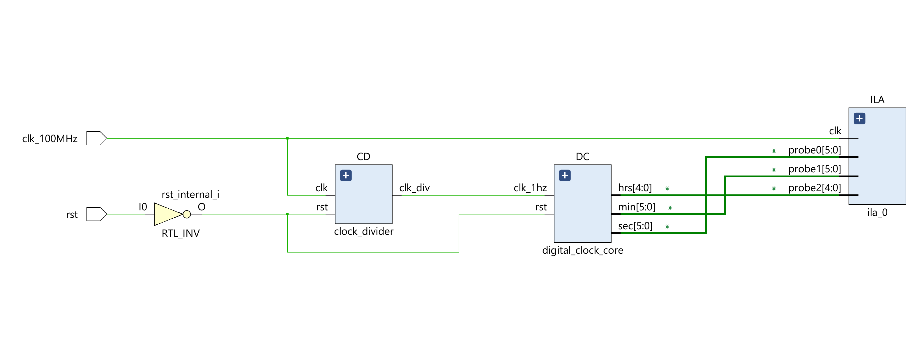
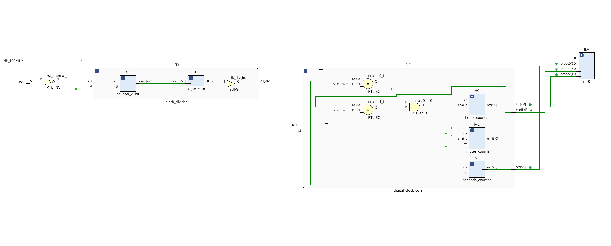
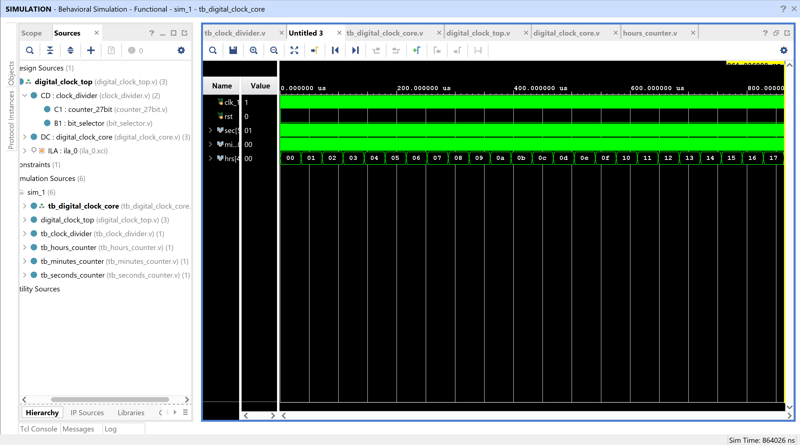

# FPGA Digital Clock Using Verilog HDL

A modular digital clock implementation using Verilog HDL on a Xilinx Artix-7 FPGA as part of the NIELIT FPGA Design Workshop.

## Project Overview

This project implements a digital clock using modular RTL design techniques in Verilog HDL. The design uses a clock divider to generate a lower-frequency clock signal, which drives the seconds, minutes, and hours counters.

The design was developed and simulated using Xilinx Vivado 2019.2 and implemented on a Nexys A7 100T FPGA development board.

An Integrated Logic Analyzer (ILA) is incorporated to monitor the internal counter signals during hardware operation.

## Hardware Platform and Tools

| Parameter | Details |
|---|---|
| FPGA Family | Xilinx Artix-7 |
| Development Board | Nexys A7 100T |
| FPGA Device | XC7A100TCSG324-1 |
| HDL | Verilog HDL |
| EDA Tool | Xilinx Vivado 2019.2 |
| Input Clock | 100 MHz |
| Verification | Vivado Simulation and ILA |
| Workshop | NIELIT FPGA Design Workshop |

## Design Architecture

The design follows a modular RTL architecture consisting of three main sections:

1. Clock Divider
2. Digital Clock Core
3. Integrated Logic Analyzer (ILA)

### Top-Level RTL Schematic



### Expanded RTL Schematic



## Design Modules

The project consists of the following Verilog modules:

| Module | Description |
|---|---|
| `counter_27bit.v` | Implements the 27-bit counter used in the clock divider. |
| `bit_selector.v` | Selects the required counter bit to generate the divided clock. |
| `clock_divider.v` | Integrates the counter and bit selector to generate the divided clock signal. |
| `seconds_counter.v` | Implements the seconds counter. |
| `minutes_counter.v` | Implements the minutes counter. |
| `hours_counter.v` | Implements the hours counter. |
| `digital_clock_core.v` | Integrates the seconds, minutes, and hours counters with the required enable logic. |
| `digital_clock_top.v` | Top-level module connecting the clock divider, digital clock core, and ILA. |

## Working Principle

### 1. Clock Division

The FPGA receives a 100 MHz input clock. A 27-bit counter increments with the incoming clock signal.

The bit selector selects the required counter bit to generate a lower-frequency clock signal.

### 2. Seconds Counter

The seconds counter increments with the divided clock and maintains the seconds value.

### 3. Minutes Counter

The minutes counter increments when the seconds counter completes its counting cycle.

### 4. Hours Counter

The hours counter increments when the minutes counter completes its counting cycle.

### 5. Integrated Logic Analyzer

The ILA is used to observe the internal operation of the digital clock.

Three probes are configured to monitor:

- `probe0[5:0]` – Seconds counter
- `probe1[5:0]` – Minutes counter
- `probe2[4:0]` – Hours counter

## Simulation Results

The design was simulated in Xilinx Vivado to verify the functionality of the individual modules and the integrated digital clock.

### Simulation Waveform



## Hardware Verification

The design was implemented on the Nexys A7 100T FPGA development board.

The Integrated Logic Analyzer (ILA) was used to monitor the internal counter signals during hardware execution.

### ILA Waveform 1


### ILA Waveform 2


## Repository Structure

```text
FPGA-Digital-Clock/
│
├── Verilog_Codes/
│   ├── bit_selector.v
│   ├── clock_divider.v
│   ├── counter_27bit.v
│   ├── digital_clock_core.v
│   ├── digital_clock_top.v
│   ├── hours_counter.v
│   ├── minutes_counter.v
│   └── seconds_counter.v
│
├── Testbench/
│   ├── tb_clock_divider.v
│   ├── tb_digital_clock_core.v
│   ├── tb_hours_counter.v
│   ├── tb_minutes_counter.v
│   └── tb_seconds_counter.v
│
├── Simulation_Results/
│   ├── RTL_Schematic_Top_Level.png
│   ├── RTL_Schematic_Expanded.png
│   ├── Simulation.png
│   ├── ILA Waveform 1.png
│   └── ILA Waveform 2.png
│
└── README.md
```

## Key Learning Outcomes

- Understanding modular RTL design using Verilog HDL.
- Implementing clock dividers using counters and bit selection.
- Designing and integrating cascaded digital counters.
- Developing and verifying Verilog testbenches.
- Understanding RTL elaboration and schematic generation in Vivado.
- Performing FPGA synthesis and implementation.
- Using Integrated Logic Analyzer (ILA) for hardware debugging and verification.

## Acknowledgements

This project was developed as part of the NIELIT FPGA Design Workshop.

**Developed using:** Verilog HDL | Xilinx Vivado 2019.2 | Artix-7 FPGA
